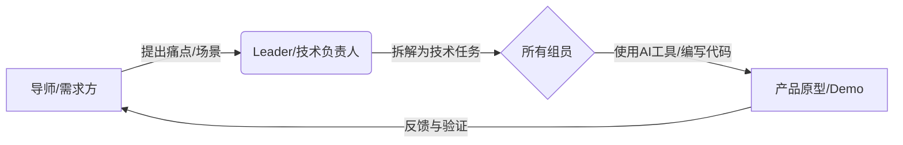
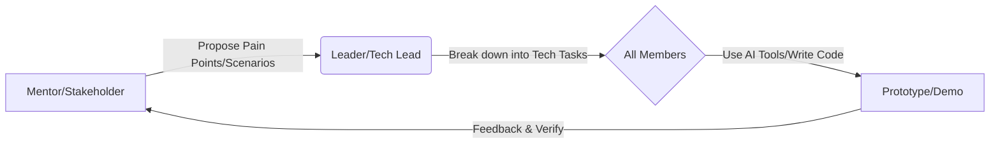
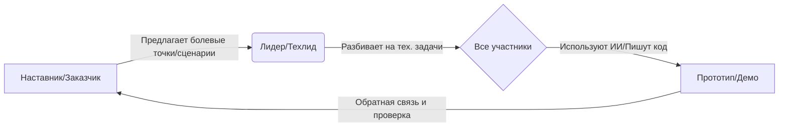

# 小X宝社区 x DKU 黑客松 - 小组对齐手册 (Team Alignment Guide)

**Language | 语言 | Язык**: [中文](#中文) | [English](#english) | [Русский](#русский)

---

## 中文

### 📌 文档目的
本文档旨在帮助**导师 (Community Admin)、Leader (DKU Student)、组员 (Volunteer)** 快速达成共识，建立高效协作循环。无论你是否具备编程背景，这里都是你开启黑客松之旅的起点。

---

### 🚀 1. 核心协作模式：合作-学习-实践循环

我们的协作不是单向的指令下达，而是一个动态循环：



#### 👥 角色分工
*   **导师 (Community Admin)**: **指南针**。负责传达一线患者/家属的真实需求（需求池），把控产品方向，确保不偏离"落地到床边"的初衷，并解答医疗场景问题。
*   **Leader (DKU Student)**: **舵手**。负责项目管理，将抽象需求拆解为GitHub Issue/Task，指导组员使用Git工具，协调开发进度，确保代码质量与合规性。
*   **组员 (参赛者)**: **划桨手**。利用自身技能（开发、设计、医学知识）结合AI工具，输出代码、文档或设计稿，完成具体任务。

---

### 💡 2. 理解需求与沟通规则

我们的目标是**解决真实问题**，而非单纯炫技。

#### 🏥 需求来源 (Where to look)
请查阅 `参考文档/需求池-种子.md`。核心关注点：
*   **七色卡矩阵**: 并发症管理、病情解读、心理疗愈等。
*   **社区痛点**: "人话"翻译医疗报告、疗法避雷、饮食/服药管理。

#### 🛡️ 沟通与合规红线 (The Rules)
1.  **绝对禁止真实数据**: 开发测试**必须**使用Mock数据（模拟数据）或LLM生成的脱敏数据。严禁上传任何真实患者姓名、病历图。
2.  **同理心沟通**: 社区里许多是患者或家属，沟通时请保持耐心与尊重。避免使用过于冷漠的技术术语，多问"这能帮您解决什么麻烦？"。
3.  **开源精神**: 项目默认采用MIT等宽松协议，旨在造福社区，而非商业闭源。

---

### 🛠️ 3. 极速上手 GitHub 协作

我们统一使用 GitHub 进行代码托管与协作。

#### 流程概览 (The Flow)
1.  **Clone (克隆)**: 将项目下载到本地。
2.  **Branch (分支)**: **不要在主分支(main/master)直接修改！** 根据任务创建新分支，如 `feature-login-page`。
3.  **Commit (提交)**: 保存你的更改。
4.  **Pull Request (PR)**: 请求将你的成果合并到主分支。

#### 常用指令速查 (Cheatsheet)
```bash
# 1. 下载项目
git clone https://github.com/your-repo.git
cd your-repo

# 2. 创建并切换新分支 (比如做登录功能)
git checkout -b feature-login

# 3. 写代码... (使用AI辅助或手写)

# 4. 提交更改
git add .
git commit -m "feat: 完成登录页面布局"

# 5. 推送分支
git push origin feature-login
```
*💡 **Leader提示**: 小组成员提交PR后，Leader应在GitHub网页端进行Code Review（代码审查），确认无误后点击Merge。*

---

### 🤖 4. Vibe Coding / Qoder CLI 实战指南

为了让非技术背景的组员也能贡献代码，或者让开发者效率倍增，我们鼓励使用 AI 编程工具。本活动特别感谢以下企业的技术支持：
*   **AI 编程工具 (Qoder)**: [https://qoder.com/](https://qoder.com/)
*   **Vibe Coding (Weavefox)**: [https://www.weavefox.cn/](https://www.weavefox.cn/)

#### 什么是 Vibe Coding?
**"跟着感觉写代码"**。你不需要精通每一行语法，只需要清晰地告诉AI你想实现什么，AI负责生成代码，你负责验证和调整。

#### 如何使用 Qoder CLI / AI 助手?
1.  **清晰的Prompt (提示词)**:
    *   ❌ 差: "帮我写个网页。"
    *   ✅ 好: "我需要一个移动端网页，包含一个输入框用于输入'血糖值'，还有一个'保存'按钮。点击保存后，将数据打印在控制台，并清空输入框。使用TailwindCSS编写样式，风格要现代简洁。"
2.  **迭代开发 (Iterate)**:
    *   先生成基础版 -> 运行查看 -> 发现问题 -> 告诉AI修复 -> 再运行。
3.  **错误处理**:
    *   遇到报错信息，直接把错误复制给AI："我运行后出现了这个错误 [错误信息]，请帮我修复。"

#### 给非技术背景组员的建议
*   把自己想象成**产品经理**或**建筑师**。
*   你的核心能力是**定义问题**和**验收结果**。
*   把繁琐的代码实现交给AI，你专注于体验是否流畅、功能是否满足导师提出的需求。

---

### 📅 5. 立即行动 (Action Items)

1.  **全员**: 加入小组群，用一句话自我介绍（背景+擅长）。
2.  **Leader**: 建立GitHub仓库，上传空的 `README.md`，邀请组员加入Collaborator。
3.  **导师**: 从需求池中选定一个具体方向（如：开发一个简单的"药物过期提醒"小工具）。
4.  **组员**: 
    *   安装环境（Node.js, Git, Cursor/VSCode）。
    *   尝试跑通 "Hello World"：拉取仓库 -> 改一行字 -> 提交PR -> Leader合并。

> **我们不是在比赛写代码的速度，而是在比赛谁能最快地把温暖的技术送到需要的人手中。** 
> *Let's Hack for Good!*

---

## English

### 📌 Purpose
This document helps **Mentors (Community Admin), Leaders (DKU Student), and Team Members (Volunteer)** quickly align and establish an efficient collaboration loop. Whether you have a coding background or not, this is your starting point for the Hackathon journey.

---

### 🚀 1. Core Collaboration: Collaborate-Learn-Practice Loop

Our collaboration is not a one-way command chain, but a dynamic loop:



#### 👥 Roles
*   **Mentor (Community Admin)**: **The Compass**. Communicates real needs from patients/families (Needs Pool), steers product direction to ensure it "lands at the bedside", and answers medical scenario questions.
*   **Leader (DKU Student)**: **The Helmsman**. Manages the project, breaks down abstract needs into GitHub Issues/Tasks, guides members in using Git, coordinates progress, and ensures code quality and compliance.
*   **Team Member (Participant)**: **The Oarsman**. Uses skills (dev, design, medical knowledge) combined with AI tools to output code, docs, or designs to complete specific tasks.

---

### 💡 2. Understanding Needs & Communication Rules

Our goal is to **solve real problems**, not just show off skills.

#### 🏥 Needs Source (Where to look)
Please check `reference-docs/需求池-种子.md`. Key focus areas:
*   **Seven-Color Cards**: Complication management, report interpretation, mental healing, etc.
*   **Community Pain Points**: "Human language" translation of medical reports, therapy scam alerts, diet/medication management.

#### 🛡️ Communication & Compliance Red Lines (The Rules)
1.  **No Real Data**: Development and testing **MUST** use Mock data or LLM-generated desensitized data. Strictly forbidden to upload any real patient names or medical records.
2.  **Empathic Communication**: Many in the community are patients or families. Be patient and respectful. Avoid cold technical jargon; ask "How can this solve your trouble?".
3.  **Open Source Spirit**: Projects default to MIT or similar permissive licenses, aiming to benefit the community, not for closed-source commercialization.

---

### 🛠️ 3. Quick Start GitHub Collaboration

We use GitHub for code hosting and collaboration.

#### Overview (The Flow)
1.  **Clone**: Download the project locally.
2.  **Branch**: **Do NOT modify main/master directly!** Create new branches for tasks, e.g., `feature-login-page`.
3.  **Commit**: Save your changes.
4.  **Pull Request (PR)**: Request to merge your work into the main branch.

#### Cheatsheet
```bash
# 1. Clone project
git clone https://github.com/your-repo.git
cd your-repo

# 2. Create and switch to new branch
git checkout -b feature-login

# 3. Write code... (Use AI or hand-code)

# 4. Commit changes
git add .
git commit -m "feat: complete login page layout"

# 5. Push branch
git push origin feature-login
```
*💡 **Leader Tip**: After members submit a PR, the Leader should Code Review on GitHub and Merge if all is good.*

---

### 🤖 4. Vibe Coding / Qoder CLI Guide

To help non-tech members contribute code and boost developer efficiency, we encourage using AI coding tools. Special thanks to our tech support partners:
*   **AI Coding Tool (Qoder)**: [https://qoder.com/](https://qoder.com/)
*   **Vibe Coding (Weavefox)**: [https://www.weavefox.cn/](https://www.weavefox.cn/)

#### What is Vibe Coding?
**"Coding by intuitive feeling"**. You don't need to master every line of syntax, just clearly tell AI what you want, AI generates the code, and you verify/adjust.

#### How to use Qoder CLI / AI Assistant?
1.  **Clear Prompts**:
    *   ❌ Bad: "Write a webpage."
    *   ✅ Good: "I need a mobile webpage with an input for 'blood glucose level' and a 'Save' button. Clicking save logs data to console and clears input. Use TailwindCSS, modern and clean style."
2.  **Iterate**:
    *   Generate basic version -> Run & Check -> Find issues -> Tell AI to fix -> Run again.
3.  **Error Handling**:
    *   If you see errors, paste them to AI: "I got this error [error message], please fix."

#### Advice for Non-Tech Members
*   Think of yourself as a **Product Manager** or **Architect**.
*   Your core skill is **Defining Problems** and **Accepting Results**.
*   Leave tedious coding to AI; focus on smooth experience and meeting Mentor's needs.

---

### 📅 5. Action Items

1.  **All**: Join the group chat, introduce yourself in one sentence.
2.  **Leader**: Create GitHub repo, upload empty `README.md`, invite members as Collaborators.
3.  **Mentor**: Pick a specific direction from the Needs Pool (e.g., simple "Medication Expiry Reminder").
4.  **Members**: 
    *   Install env (Node.js, Git, Cursor/VSCode).
    *   Run "Hello World": Clone repo -> Change one line -> Submit PR -> Leader merge.

> **We are not racing to code fast, but racing to deliver warm technology to those in need.**
> *Let's Hack for Good!*

---

## Русский

### 📌 Цель документа
Этот документ помогает **Наставникам (Community Admin), Лидерам (DKU Student) и Участникам (Volunteer)** быстро достичь взаимопонимания и наладить эффективный цикл сотрудничества. Независимо от наличия опыта программирования, это ваш старт в Хакатоне.

---

### 🚀 1. Основная модель сотрудничества: Цикл Сотрудничество-Обучение-Практика

Наше сотрудничество — это не односторонняя передача команд, а динамичный цикл:



#### 👥 Роли
*   **Наставник (Community Admin)**: **Компас**. Передает реальные потребности пациентов/семей (Пул потребностей), контролирует направление продукта, чтобы он "приземлился у постели больного", и отвечает на вопросы по мед. сценариям.
*   **Лидер (DKU Student)**: **Рулевой**. Управляет проектом, разбивает абстрактные потребности на GitHub Issues/Tasks, направляет участников в использовании Git, координирует прогресс, следит за качеством кода и соответствием требованиям.
*   **Участник (Volunteer)**: **Гребец**. Использует навыки (разработка, дизайн, мед. знания) вместе с ИИ-инструментами для создания кода, доков или дизайна для выполнения задач.

---

### 💡 2. Понимание потребностей и правила коммуникации

Наша цель — **решать реальные проблемы**, а не просто демонстрировать навыки.

#### 🏥 Источник потребностей (Where to look)
См. `reference-docs/需求池-种子.md`. Основные направления:
*   **Матрица семицветных карт**: Управление осложнениями, интерпретация состояния, душевное исцеление.
*   **Болевые точки сообщества**: Перевод мед. отчетов на "человеческий язык", предупреждение о мошенничестве в терапии, управление питанием/лекарствами.

#### 🛡️ Коммуникация и Красные линии (The Rules)
1.  **Никаких реальных данных**: Разработка и тесты **ОБЯЗАНЫ** использовать Mock-данные или обезличенные данные от LLM. Строго запрещено загружать реальные имена пациентов или мед. карты.
2.  **Эмпатичная коммуникация**: Многие в сообществе — пациенты или их семьи. Будьте терпеливы и уважительны. Избегайте холодного тех. жаргона; спрашивайте "Как это поможет решить вашу проблему?".
3.  **Дух Open Source**: Проекты по умолчанию используют MIT или подобные лицензии, чтобы приносить пользу сообществу, а не для коммерческого закрытого использования.

---

### 🛠️ 3. Быстрый старт в GitHub

Мы используем GitHub для хостинга кода и сотрудничества.

#### Обзор процесса (The Flow)
1.  **Clone (Клон)**: Скачать проект локально.
2.  **Branch (Ветка)**: **НЕ меняйте main/master напрямую!** Создавайте новые ветки для задач, например `feature-login-page`.
3.  **Commit (Коммит)**: Сохранить изменения.
4.  **Pull Request (PR)**: Запрос на слияние вашей работы в основную ветку.

#### Шпаргалка (Cheatsheet)
```bash
# 1. Скачать проект
git clone https://github.com/your-repo.git
cd your-repo

# 2. Создать и переключиться на новую ветку
git checkout -b feature-login

# 3. Писать код... (Используйте ИИ или вручную)

# 4. Коммит изменений
git add .
git commit -m "feat: complete login page layout"

# 5. Отправить ветку
git push origin feature-login
```
*💡 **Совет Лидеру**: После того как участники отправят PR, Лидер должен провести Code Review на GitHub и сделать Merge, если все ок.*

---

### 🤖 4. Руководство по Vibe Coding / Qoder CLI

Чтобы помочь нетехническим участникам вносить вклад и повысить эффективность разработчиков, мы поощряем использование ИИ-инструментов. Особая благодарность партнерам техподдержки:
*   **ИИ-инструмент кодинга (Qoder)**: [https://qoder.com/](https://qoder.com/)
*   **Vibe Coding (Weavefox)**: [https://www.weavefox.cn/](https://www.weavefox.cn/)

#### Что такое Vibe Coding?
**"Кодинг по наитию"**. Вам не нужно знать каждую строчку синтаксиса, просто четко скажите ИИ, что вы хотите, ИИ сгенерирует код, а вы проверите/поправите.

#### Как использовать Qoder CLI / AI Assistant?
1.  **Четкие промпты**:
    *   ❌ Плохо: "Напиши веб-страницу."
    *   ✅ Хорошо: "Мне нужна мобильная веб-страница с полем ввода 'уровень сахара' и кнопкой 'Сохранить'. Клик сохраняет данные в консоль и очищает поле. Используй TailwindCSS, стиль современный и чистый."
2.  **Итерация**:
    *   Сгенерировать базу -> Запустить и проверить -> Найти проблемы -> Сказать ИИ исправить -> Запустить снова.
3.  **Обработка ошибок**:
    *   Если видите ошибки, скопируйте их ИИ: "У меня такая ошибка [текст ошибки], исправь пожалуйста."

#### Совет для нетехнических участников
*   Представьте себя **Продуктовым менеджером** или **Архитектором**.
*   Ваш ключевой навык — **Определение проблем** и **Приемка результатов**.
*   Оставьте скучный кодинг ИИ; сосредоточьтесь на плавном опыте и удовлетворении потребностей Наставника.

---

### 📅 5. Действуй сейчас (Action Items)

1.  **Все**: Вступить в группу, представиться одним предложением.
2.  **Лидер**: Создать репозиторий GitHub, загрузить пустой `README.md`, пригласить участников как Collaborators.
3.  **Наставник**: Выбрать конкретное направление из Пула потребностей (напр.: простой "Напоминатель срока годности лекарств").
4.  **Участники**: 
    *   Установить среду (Node.js, Git, Cursor/VSCode).
    *   Запустить "Hello World": Клон репо -> Изменить одну строку -> Отправить PR -> Лидер мерджит.

> **Мы не соревнуемся в скорости написания кода, мы соревнуемся в том, кто быстрее доставит тепло технологий тем, кто в этом нуждается.**
> *Let's Hack for Good!*
